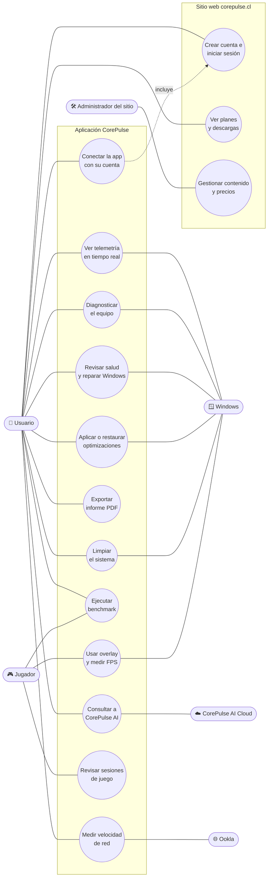
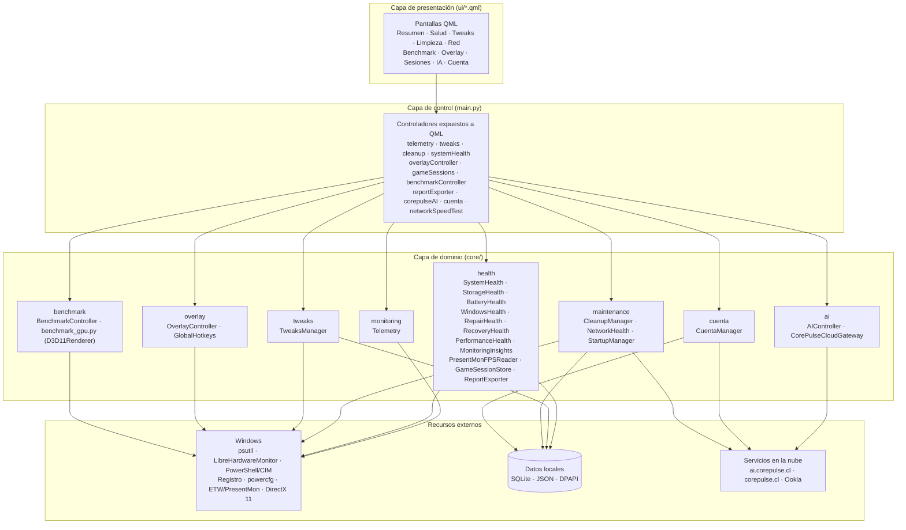
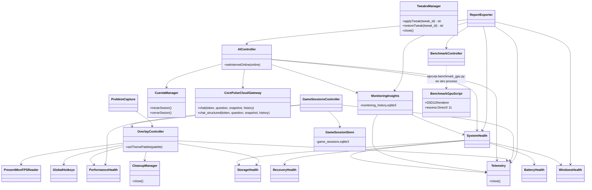
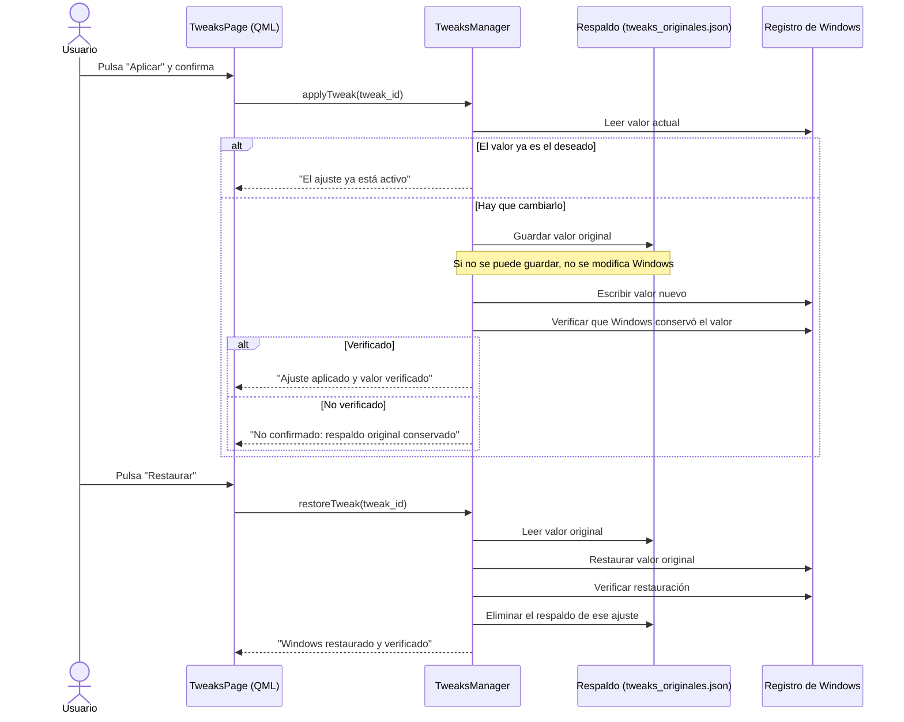
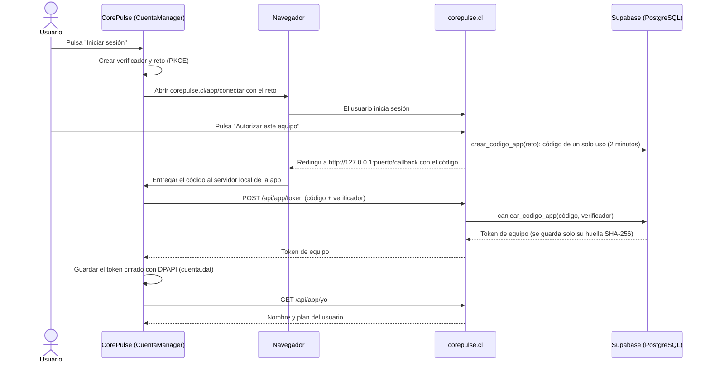
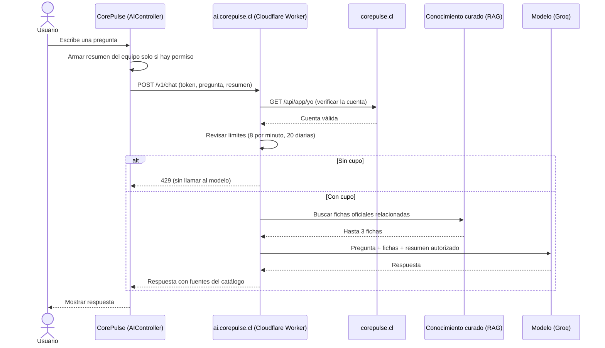
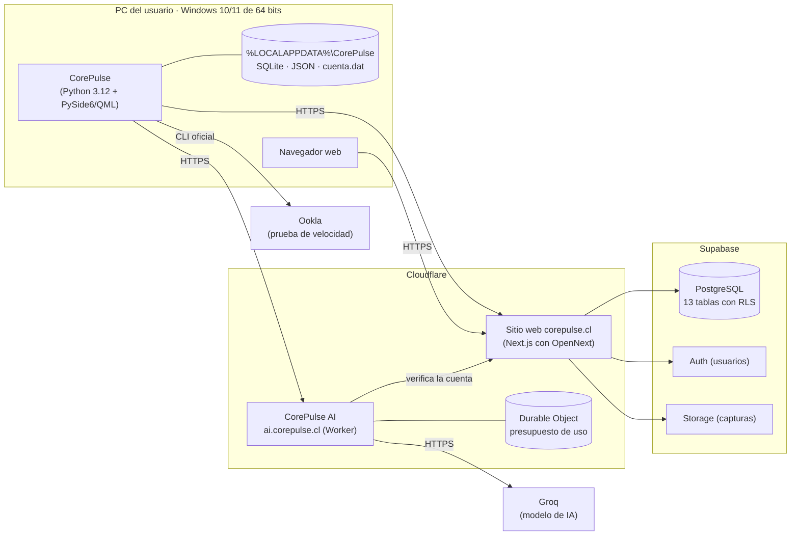

# Diagramas UML de CorePulse

Diagramas UML del sistema CorePulse (REBUILD 210 y sitio web corepulse.cl). Los nombres de clases y métodos corresponden al código fuente en `Evidencias de sistema/Aplicación/`. Los diagramas están escritos en Mermaid, que GitHub muestra como imagen.

Contenido:

1. Diagrama de casos de uso
2. Diagrama de componentes
3. Diagrama de clases (controladores principales)
4. Diagrama de secuencia: aplicar y restaurar un tweak
5. Diagrama de secuencia: conectar la app con la cuenta web
6. Diagrama de secuencia: consulta a CorePulse AI
7. Diagrama de despliegue

El modelo de datos y sus diagramas entidad-relación están en `Evidencias de sistema/Base de datos/modelo_datos.md`.

---

## 1. Diagrama de casos de uso

Actores: **Usuario** (cualquier persona que usa CorePulse en su PC), **Jugador** (usuario que usa las funciones de juego), **Administrador del sitio** (integrante del equipo que gestiona el contenido web) y los sistemas externos **Windows**, **CorePulse AI Cloud** y **Ookla**.

| Caso de uso | Descripción |
|---|---|
| Ver telemetría en tiempo real | Muestra uso y temperatura de CPU, GPU, RAM y discos, con su fuente o N/A |
| Diagnosticar el equipo | Revisa el equipo y entrega un estado general con hallazgos |
| Revisar salud y reparar Windows | Batería, almacenamiento SMART/NVMe, análisis y reparación con DISM/SFC, recuperación |
| Aplicar o restaurar optimizaciones | Aplica un tweak guardando el valor original y lo restaura cuando el usuario quiera |
| Limpiar el sistema | Temporales, caché, RAM, Papelera y DNS, con confirmación |
| Exportar informe PDF | Genera un informe con lecturas, diagnóstico y resultados |
| Consultar a CorePulse AI | Pregunta sobre el equipo; la IA solo usa los datos que el usuario autoriza |
| Ejecutar benchmark | Pruebas de CPU, RAM, disco y GPU con veredicto e historial |
| Medir velocidad de red | Prueba con la CLI oficial de Ookla sobre el adaptador verificado |
| Usar overlay y medir FPS | Muestra FPS y uso del equipo sobre el juego |
| Revisar sesiones de juego | Historial de partidas con FPS, 1 % low e incidencias |
| Conectar la app con su cuenta | Inicia sesión en la web y autoriza el equipo sin escribir la contraseña en la app |

---

## 2. Diagrama de componentes

La aplicación de escritorio tiene tres capas: la interfaz QML, los controladores que `main.py` expone a QML y los módulos de `core/`. La interfaz nunca accede directo a Windows.

---

## 3. Diagrama de clases (controladores principales)

Clases principales y sus dependencias, según cómo se construyen en `main.py`. Se muestran solo los atributos y métodos más relevantes.

---

## 4. Diagrama de secuencia: aplicar y restaurar un tweak

Muestra cómo `TweaksManager` garantiza que cada cambio en Windows sea reversible: guarda el valor original antes de escribir y verifica el resultado.

---

## 5. Diagrama de secuencia: conectar la app con la cuenta web

La app de escritorio nunca recibe ni guarda la contraseña del usuario. Usa un código de un solo uso con verificador (PKCE).

---

## 6. Diagrama de secuencia: consulta a CorePulse AI

El servidor verifica la cuenta y los límites de uso antes de llamar al modelo. Los datos del equipo solo viajan si el usuario activó ese permiso.

---

## 7. Diagrama de despliegue

