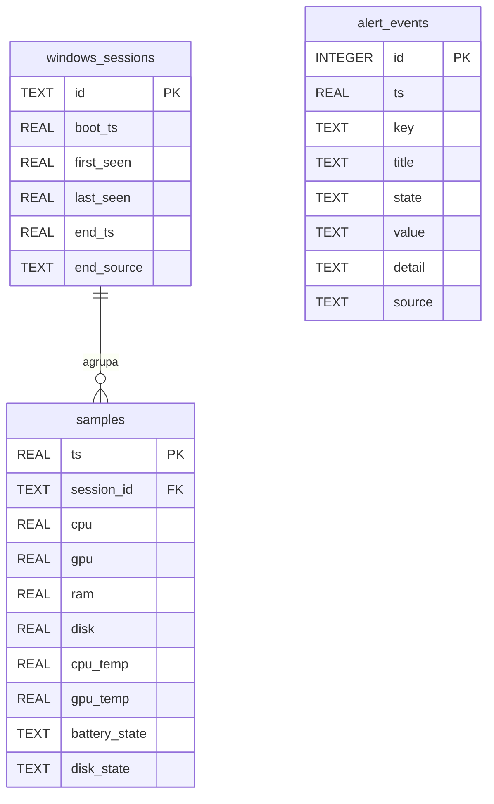
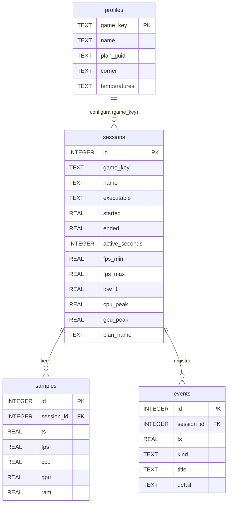
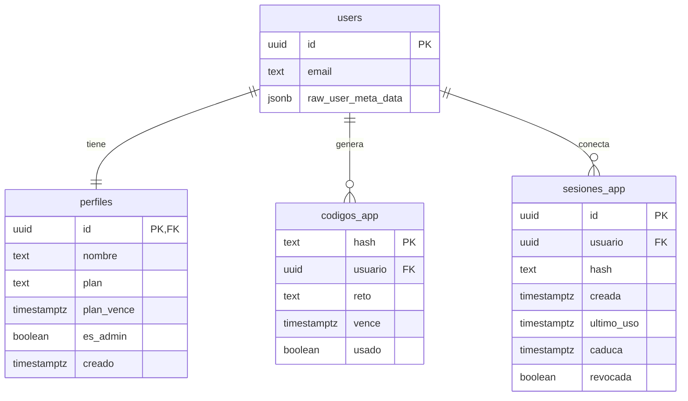

# Modelo de datos de CorePulse

CorePulse usa dos bases de datos con propósitos distintos:

1. **Base de datos local (SQLite)**, dentro del equipo del usuario. La crea y usa la aplicación de escritorio. Guarda el historial de monitoreo, las alertas y las sesiones de juego. Estos datos **nunca salen del equipo**.
2. **Base de datos web (PostgreSQL en Supabase)**, en la nube. La usa el sitio corepulse.cl. Guarda el contenido del sitio, las cuentas de usuario y el enlace seguro entre la aplicación de escritorio y la cuenta web.

Además, la aplicación guarda respaldos en archivos JSON/JSONL (estado original de cada optimización de Windows, historial de benchmark) y el token de la cuenta cifrado con DPAPI de Windows (`cuenta.dat`). La contraseña del usuario nunca se guarda en el equipo.

## 1. Base de datos local: monitoreo

Archivo: `%LOCALAPPDATA%\CorePulse\rebuild\monitoring_history.sqlite3`. Script: [`sqlite/monitoring_history.sql`](sqlite/monitoring_history.sql).

| Tabla | Clave primaria | Descripción |
|---|---|---|
| windows_sessions | id | Una fila por cada arranque de Windows, con su hora de arranque, primera y última muestra, y cierre |
| samples | ts | Muestras de uso cada 30 segundos (CPU, GPU, RAM, disco, temperaturas, batería y disco). Se conservan 90 días |
| alert_events | id | Cada cambio de estado de una alerta, con su valor, detalle y fuente del dato |

Relación: cada muestra (`samples.session_id`) pertenece a una sesión de Windows (`windows_sessions.id`). Una sesión de Windows tiene muchas muestras (relación uno a muchos).

## 2. Base de datos local: sesiones de juego

Archivo: `%LOCALAPPDATA%\CorePulse\rebuild\game_sessions.sqlite3`. Script: [`sqlite/game_sessions.sql`](sqlite/game_sessions.sql).

| Tabla | Clave primaria | Descripción |
|---|---|---|
| sessions | id | Una fila por partida: juego, inicio, término, tiempo activo, FPS (promedio, mínimo, máximo, 1 % low), picos de CPU y GPU, y plan de energía |
| samples | id | Lecturas durante la partida (FPS, CPU, GPU, RAM y temperaturas) |
| events | id | Incidencias de la partida, como caídas de FPS o temperatura alta |
| profiles | game_key | Preferencias por juego: plan de energía, esquina del overlay y temperaturas |

Relaciones: una partida (`sessions`) tiene muchas lecturas (`samples`) y muchas incidencias (`events`). Las claves foráneas usan `ON DELETE CASCADE`: al borrar una partida se borran sus lecturas e incidencias. `profiles` se relaciona con `sessions` por `game_key`.

## 3. Base de datos web (Supabase / PostgreSQL)

Scripts: [`supabase/migraciones/`](supabase/migraciones/) (10 migraciones, en orden de fecha).

### 3.1 Cuentas de usuario y aplicación de escritorio

| Tabla | Clave primaria | Descripción |
|---|---|---|
| auth.users | id | Usuarios registrados. La administra Supabase Auth (correo y contraseña cifrada) |
| perfiles | id (FK a auth.users) | Nombre, plan (free o pro), vencimiento del plan y si es administrador. Se crea solo al registrarse (trigger `al_crear_usuario`) |
| codigos_app | hash | Código de un solo uso (2 minutos) para conectar la app de escritorio con la cuenta. Solo se guarda su huella SHA-256 |
| sesiones_app | id | Equipos conectados a la cuenta: huella del token, creación, último uso, caducidad y si fue desconectado |

Relaciones: un usuario tiene un perfil (uno a uno), muchos códigos de conexión y muchos equipos conectados (uno a muchos). Todas usan `ON DELETE CASCADE`: si se borra el usuario, se borran sus datos.

### 3.2 Contenido del sitio

Tablas independientes (sin relaciones entre sí) que el sitio lee para mostrar su contenido. Todas se pueden leer públicamente y solo se modifican desde el panel de administración o con migraciones.

| Tabla | Clave primaria | Descripción |
|---|---|---|
| ajustes | clave | Textos y opciones generales del sitio (JSON) |
| planes | slug | Planes Free y Pro con precios en CLP |
| plan_caracteristicas | id | Comparación de funciones entre planes |
| preguntas | id | Preguntas frecuentes |
| funciones | slug | Funciones de la aplicación con su captura |
| destacados | id | Bloques destacados de la portada |
| cifras | id | Cifras de la portada |
| temas | id | Temas visuales de la aplicación |
| versiones | id | Versiones publicadas (se sincronizan desde GitHub) |
| documentos_legales | slug | Términos y política de privacidad |

### 3.3 Seguridad

- Todas las tablas tienen **seguridad por fila (RLS)** activada.
- El contenido del sitio se puede leer, pero no modificar desde el navegador.
- Cada usuario solo puede ver y modificar su propio perfil y sus propios equipos.
- Los códigos y tokens de la app se guardan como huellas SHA-256, nunca en texto plano.
- Las operaciones sensibles (conectar la app, dar o quitar administrador) se hacen con funciones `security definer` que validan los permisos.
