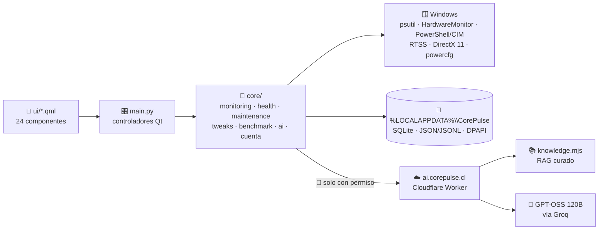
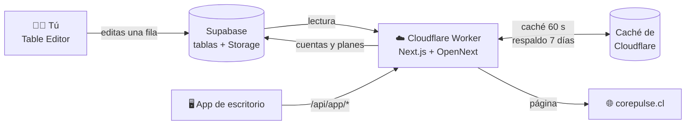
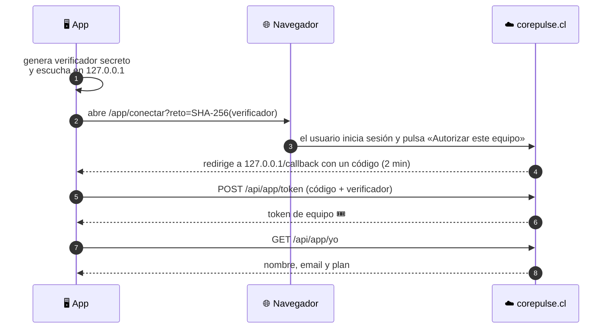

<!-- ===================== CABECERA ===================== -->
<p align="center">
  
</p>

<p align="center">
  <a href="#"></a>
</p>

<p align="center">
  
  
  
  
  
</p>

<p align="center">
  
</p>

---

## 🤔 ¿Qué es CorePulse?

¿Alguna vez abriste **cinco programas distintos** solo para saber por qué tu PC anda lenta? 🐌
Uno para temperaturas, otro para el disco, otro para los FPS, otro para limpiar...

**CorePulse junta todo en una sola app** 🧩 y además te lo explica en español, sin humo:

> 💡 Si un sensor no existe en tu equipo, CorePulse te muestra **`N/A`**.
> Nunca vas a ver un número inventado. **Dato real o nada.**

---

## ✨ Lo que trae

| | Módulo | Qué hace |
|:-:|---|---|
| 📊 | **Resumen en vivo** | CPU, GPU (🟢 NVIDIA · 🔴 AMD · 🔵 Intel), RAM y almacenamiento en tiempo real, con el logo de cada fabricante |
| 🩺 | **Centro de Salud** | Revisa Windows, repara con **DISM/SFC**, lee **SMART/NVMe** y te dice cuánto se gastó tu disco |
| 🔍 | **Diagnóstico** | Un botón ❤️‍🔥 que late mientras analiza y termina en un **PDF** listo para compartir |
| 🤖 | **CorePulse AI** | Te explica el diagnóstico con **fuentes oficiales** (Microsoft, Intel, AMD, NVIDIA) y compara la salud de tu PC **entre arranques** |
| ⚙️ | **Tweaks de Windows 11** | 78 optimizaciones que guardan **cómo estaba todo antes**: un clic y vuelve atrás ↩️ |
| 🧹 | **Limpieza** | Temporales, caché, RAM, duplicados y Papelera, siempre con confirmación |
| 🎮 | **Gaming** | Overlay con **FPS reales** (RTSS), Game Boost reversible y plan de energía automático por juego |
| 🏙️ | **Benchmark GPU** | Una ciudad de neón en **DirectX 11** que exprime tu tarjeta y guarda el historial para comparar |
| 📈 | **Tendencias** | Tu uso agrupado por **sesión de Windows**, para ver si el problema se repite |
| 🌐 | **Red avanzada** | Adaptadores, tráfico y Speedtest, con tu IP escondida detrás de un 👁️ |
| 🎨 | **Temas** | 15 paletas con estilo **Liquid Glass** 🫧 |

### 🆕 Novedades de la versión actual (REBUILD 146)

- Logotipo **AMD** completo, con el nombre de la marca y su flecha oficial.
- Icono y etiqueta de almacenamiento según lo que informa Windows: **HDD mecánico, SSD SATA o SSD NVMe**, y un icono genérico cuando Windows no informa el tipo.
- Almacenamiento en **violeta fijo**; el cian de RAM y los colores de CPU/GPU no cambian.
- Sin dependencias nuevas ni cambios en los motores de telemetría.

El detalle de cada versión está en [`versiones/HISTORIAL.md`](FASE%202/Evidencias%20Proyecto/CorePulse_REBUILD_146/versiones/HISTORIAL.md) 📜

---

## 🛡️ Las 3 reglas de oro

```text
1️⃣  Dato real o N/A          → nada se estima, nada se inventa
2️⃣  Todo se puede deshacer    → snapshot ➜ verificación ➜ restaurar
3️⃣  Nada sale sin permiso     → compartir hardware o historial viene APAGADO
```

<details>
<summary>🔐 <b>¿Qué datos salen de mi PC?</b> (clic para ver)</summary>

<br>

| Dato | ¿Sale del equipo? |
|---|---|
| Lecturas de sensores, historial, respaldos de tweaks | ❌ Nunca: quedan en `%LOCALAPPDATA%\CorePulse` |
| Preguntas que escribís a CorePulse AI | ✅ Solo las que vos enviás |
| Resumen de hardware para la IA | ⚪ Solo si activás ese permiso |
| Resumen de Tendencias para la IA | ⚪ Solo si activás ese otro permiso |
| IP, MAC, SSID, ubicación | ❌ Nunca |

</details>

---

## 🚀 Probarlo en 2 pasos

```bash
# 1️⃣ Entrá a la carpeta de la versión actual
cd "FASE 2/Evidencias Proyecto/CorePulse_REBUILD_146"

# 2️⃣ Doble clic o desde la terminal
Iniciar_CorePulse.bat
```

> ☕ La primera vez tarda un poco: prepara su propio entorno de Python e instala lo que necesita.
> Requisitos: **Windows 10/11 de 64 bits** y **Python 3.12+**.
> El encabezado de la app debe decir **Rebuild 146**. Los informes se guardan en `%LOCALAPPDATA%\CorePulse\reportes`.

---

## 🛠️ Guía técnica

> 🧭 Para quien va a meter mano al código. Si solo querés usar la app, con lo de arriba alcanza.

<p>
  
  
  
  
  
</p>

### 🗺️ El mapa del tesoro (arquitectura)



**Tres capas, una regla:** la interfaz nunca habla con Windows directo. Todo pasa por `core/`,
y lo pesado (WMI, sensores, NVIDIA-SMI) corre en hilos o procesos aparte para que la UI no se congele 🧊.

<details>
<summary>📂 <b>¿Qué hay en cada carpeta?</b> (dentro de <code>FASE 2/Evidencias Proyecto/CorePulse_REBUILD_146/</code>)</summary>

<br>

| Carpeta | Contenido |
|---|---|
| `ui/` | Pantallas QML. `GlassPanel.qml` es el material Liquid Glass 🫧 que usan todas las tarjetas |
| `core/monitoring/` | Telemetría en vivo (CPU, GPU multivendedor, RAM, disco) |
| `core/health/` | Salud, diagnóstico, PDF, FPS, Game Boost, tendencias, almacenamiento |
| `core/maintenance/` | Limpieza, red, drivers, inicio de Windows, Speedtest, test de audio |
| `core/tweaks/` | Motor de tweaks reversibles 🔄 |
| `core/ai.py` | Cliente de CorePulse AI Cloud |
| `core/benchmark_gpu.py` | El benchmark DirectX 11 de la ciudad de neón 🏙️ |
| `cloud/corepulse-ai/` | El Worker de Cloudflare: API, RAG y control de cuotas |
| `tests/` | Suite pytest de la app y del cliente cloud |
| `versiones/HISTORIAL.md` | La bitácora de cada versión 📜 |

</details>

### 💾 Dónde guarda las cosas

Todo vive en `%LOCALAPPDATA%\CorePulse`:

| Archivo | Tipo | Para qué |
|---|---|---|
| `monitoring_history.sqlite3` → `samples` | 🗃️ SQLite | Muestras cada 30 s, retención de 90 días |
| `monitoring_history.sqlite3` → `windows_sessions` | 🗃️ SQLite | Un registro por arranque de Windows |
| `monitoring_history.sqlite3` → `alert_events` | 🗃️ SQLite | Historial de alertas con su fuente |
| `windows_tweaks_state.json` | 📄 JSON | Cómo estaba Windows antes de cada tweak ↩️ |
| `benchmark_historial.jsonl` | 📄 JSONL | Hasta 500 sesiones de benchmark |
| `cuenta.dat` | 🔒 DPAPI | Token de la cuenta, cifrado por Windows |
| `reportes\` | 📄 PDF | Informes de diagnóstico y de benchmark |

### 🏃 Ejecutar y probar

```bash
cd "FASE 2/Evidencias Proyecto/CorePulse_REBUILD_146"

# ▶️ Arrancar (prepara el entorno aislado la primera vez)
Iniciar_CorePulse.bat

# 🧪 Correr las pruebas sin dejar __pycache__
python -B -m pytest -p no:cacheprovider -q tests
```

**Dependencias** (se instalan solas): `PySide6` · `psutil` · `pythonnet` · `HardwareMonitor`

---

## ☁️ CorePulse AI Cloud

El servidor de la IA vive en `FASE 2/Evidencias Proyecto/CorePulse_REBUILD_146/cloud/corepulse-ai/`: un **Cloudflare Worker** (`corepulse-ai-cloud`) publicado en **`https://ai.corepulse.cl`**. La app lo usa por defecto: el usuario no configura URL ni claves.

| Pieza | Detalle |
|---|---|
| 🧠 Modelo | GPT-OSS 120B vía **Groq** (`openai/gpt-oss-120b`). La clave del proveedor vive **solo** en Cloudflare como secreto |
| 📚 Conocimiento | RAG léxico sobre fichas oficiales curadas (Microsoft, Intel, AMD, NVIDIA) en `src/knowledge.mjs`, versión `corepulse-kb-v3`. Sin búsqueda web ni índice vectorial |
| 🔌 Rutas | `GET /v1/health` (solo confirma que responde) · `GET /v1/status` · `POST /v1/chat` · `POST /v1/analyze` (reglas propias, no gasta Groq) |
| 🚦 Límites | 8 consultas por minuto por usuario · **20** consultas generativas diarias por cuenta · **250** diarias y **3000** mensuales en total (Durable Object SQLite `MODEL_BUDGET`, reinicio en UTC) |

**Cómo responde la IA, paso a paso:**
1. 🔑 Verifica tu cuenta CorePulse contra `corepulse.cl/api/app/yo` (no confía en el `userId` que manda el cliente).
2. 🚦 Aplica el límite de consultas y el presupuesto **antes** de llamar al modelo; si no hay cupo responde `429` sin contactar a Groq.
3. 📚 Busca hasta 3 fichas oficiales relacionadas con tu pregunta (RAG).
4. 📏 Si comparás sesiones, **las reglas propias deciden** si el problema se repite (por ejemplo, CPU ≥ 90 °C durante 3 min). El modelo solo lo explica, y la respuesta trae resumen (`answer`) y dictamen completo (`details`) en una sola llamada.
5. 🔗 Las fuentes salen del catálogo, nunca del modelo.

<details>
<summary>🔐 <b>Privacidad del servidor</b></summary>

<br>

- El Worker no guarda conversaciones, IP ni telemetría en bases de datos; los contadores usan claves hash.
- Hardware: sin permiso se envía `{}`. Con permiso, solo nombres acotados y uso de CPU/GPU/RAM/disco, sin identificadores, rutas ni números de serie.
- Tendencias: un **permiso aparte, apagado por defecto**. Solo viajan contadores, picos y rachas calculados en el equipo; nunca muestras crudas, fechas exactas, nombres ni IDs.
- Nunca se aceptan mensajes de tipo `system` desde el cliente.
- Los límites cuentan **consultas**, no dinero ni tokens: configurar también alertas de gasto en el proveedor.

</details>

### 🚀 Probar y publicar el Worker

Desde PowerShell, con Node.js 22+:

```powershell
cd "FASE 2\Evidencias Proyecto\CorePulse_REBUILD_146\cloud\corepulse-ai"
npm.cmd install          # 📦 dependencias (Wrangler 4.151.1 fijado)
npm.cmd run verify       # ✅ sintaxis + 61 pruebas (simuladas, no gastan tokens)
npm.cmd audit            # 🔍 revisar antes de publicar; nunca "npm audit fix --force" a ciegas
npx.cmd wrangler whoami  # 👤 si no hay sesión: npx.cmd wrangler login (lo hace el dueño de la cuenta)
npx.cmd wrangler deploy  # 🚀 publicar en ai.corepulse.cl
```

> ⚠️ **No** volver a ejecutar `wrangler secret put`, **no** crear otro Worker, dominio ni Durable Object, y **nunca** subir tokens, claves ni `.dev.vars`.
> El deploy está completo solo cuando muestra `Deployed` junto a `ai.corepulse.cl` y un `Current Version ID`. `/v1/health` no prueba el modelo: la validación real es una pregunta autenticada desde la app.

---

## 🧭 Cómo se trabaja en el proyecto

### 📜 Reglas para crear una versión nueva

```text
📖  Leer completos "Reglas para crear Versiones nuevas.txt" y versiones/HISTORIAL.md
✍️  Agregar la entrada ARRIBA del historial: base · cambios · validación · reversión
🧹  Quitar el código que quedó obsoleto; no llenar el proyecto de .py nuevos
🧪  Correr las pruebas: ninguna versión debería sumar fallos nuevos
📦  Guardar el ZIP de respaldo de la versión anterior (con el TXT de reglas adentro)
```

### 🌳 Trabajo con Git

| ✅ Sí | ❌ No |
|---|---|
| `git pull` antes de subir | `git push --force` sobre `main` 💥 |
| Una rama por integrante (`maxi/corepulse-dev`, ...) | Subir tokens, claves o `.env` |
| Mensajes de commit claros | Subir `__pycache__` o entornos virtuales |

---

## 👥 El equipo

<table align="center">
  <tr>
    <td align="center" width="200">
      <a href="https://github.com/tomashoytbarri24"><br><b>Tomás Hoyt</b></a><br>
      🏗️ Arquitectura · 📡 Telemetría · 🤖 IA
    </td>
    <td align="center" width="200">
      <a href="https://github.com/agtttttttttttt"><br><b>Agustín Valdés</b></a><br>
      🌐 Desarrollo web · ✅ Validación · 📝 Documentación
    </td>
    <td align="center" width="200">
      <a href="https://github.com/maxicpa"><br><b>Maximiliano Carrasco</b></a><br>
      🎨 Interfaz · 🏙️ Benchmark · 🧪 Pruebas
    </td>
  </tr>
</table>

<p align="center">
  🎓 Proyecto <b>Capstone (PTY4614)</b> · Ingeniería en Informática · <b>Duoc UC</b> Valparaíso · Equipo 14
</p>

<p align="center">🧡 Hecho con mucho café por el equipo 14 · Duoc UC</p>

<p align="center">
  
</p>

<br>

<!-- ===================== README DE LA WEB ===================== -->
<p align="center">
  
</p>

<div align="center">


# 🌐 CorePulse Web

**La web de CorePulse: precios, descargas, novedades y cuentas de usuario.**

[corepulse.cl](https://corepulse.cl) · [Funciones](https://corepulse.cl/funciones) · [Precios](https://corepulse.cl/precios) · [Descargar](https://corepulse.cl/descargar)


</div>

> 📁 El código de la web está en [`FASE 2/Evidencias Proyecto/CorePulse-web/`](FASE%202/Evidencias%20Proyecto/CorePulse-web). Todas las rutas y comandos de esta parte son relativos a esa carpeta.

**Todo el contenido sale de Supabase**: textos, precios, planes, funciones, novedades, preguntas, legales e imágenes. En el código solo quedan etiquetas de interfaz (botones, menús). ¿Quieres cambiar un precio? Se edita una fila en Supabase y no hace falta tocar el código.

**Stack:** Next.js 16 (React 19) · Tailwind CSS 4 · Motion + Lenis (animaciones) · Supabase (base de datos, Auth y Storage) · Cloudflare Workers con OpenNext (hosting) en `https://corepulse.cl`.

### ⚡ CorePulse Web en 30 segundos



Si Supabase se cae, la web sigue funcionando con la última copia guardada.

#### Así inicia sesión la app de escritorio (sin pedir la contraseña)



### 🚀 Puesta en marcha

<details>
<summary><b>1. Supabase</b> · base de datos, cuentas e imágenes</summary>

1. **SQL Editor** → ejecuta en orden los archivos de `supabase/migrations/`:
   1. `…_contenido.sql`: tablas del contenido, seguridad (RLS) y bucket `capturas`.
   2. `…_datos_iniciales.sql`: el contenido actual de la web (se puede repetir sin duplicar).
   3. `…_cuentas.sql`: perfiles de usuario con su plan.
   4. `…_precios_clp_y_limite_free.sql`: precios en pesos chilenos y plan Free con 2 usos por función.
   5. `…_app_escritorio.sql`: inicio de sesión de la app de escritorio.
   6. `…_caducidad_tokens_app.sql`: los tokens de la app caducan (30 días sin uso o 180 días desde que se conectó el equipo).
   7. `…_administradores.sql`: cuentas admin que pueden cambiar los precios desde `/cuenta/admin`.
   8. `…_gestionar_admins.sql`: los admins dan o quitan admin a otras cuentas por email.
   9. `…_capturas_windows.sql`: usa las capturas sacadas en Windows (con todas las métricas visibles).
   10. `…_novedades_github.sql`: vacía Novedades y la prepara para recibir las versiones desde GitHub.
2. **Authentication → URL Configuration:**
   - *Site URL:* `https://corepulse.cl`.
   - *Redirect URLs:* añade `https://corepulse.cl/auth/callback` y `http://localhost:3000/auth/callback`.
3. **Authentication → Sign In / Providers → Email:** deja activado *Confirm email*.
4. Copia `.env.example` como `.env.local` y rellena las claves (**Project Settings → API Keys**).
5. Sube las imágenes al Storage:
   ```bash
   npm run subir-capturas
   ```

</details>

<details>
<summary><b>2. Cloudflare Workers</b> · hosting en corepulse.cl</summary>

1. **Workers & Pages → Create → Import a repository** → elige el repositorio (Workers Builds) e indica como *Root directory* la carpeta `FASE 2/Evidencias Proyecto/CorePulse-web`. Usa la configuración por defecto: `npm run build` compila con OpenNext y `wrangler.jsonc` define el Worker y los dominios `corepulse.cl` y `www.corepulse.cl`.
2. Las variables públicas de compilación (`NEXT_PUBLIC_SUPABASE_URL`, `NEXT_PUBLIC_SUPABASE_PUBLISHABLE_KEY`, `NEXT_PUBLIC_SITE_URL`) están en `.env.production`. Si prefieres definirlas en Cloudflare, ponlas en **Settings → Build → Variables** y en **Settings → Variables and Secrets**.
3. Cada `git push` a la rama configurada en Workers Builds vuelve a publicar. A mano: `npm run deploy`.

> [!WARNING]
> Las variables `NEXT_PUBLIC_*` se incrustan al compilar: si las cambias, lanza una nueva compilación.
> **Nunca** pongas `SUPABASE_SECRET_KEY` en Cloudflare: solo se usa en tu equipo para subir imágenes.

</details>

### ✏️ Editar el contenido

Todo se edita en **Supabase → Table Editor**. La web se actualiza sola en un máximo de **60 segundos**: las lecturas de Supabase se guardan un minuto en la caché de Cloudflare (`src/lib/supabase/cache.ts`). Si Supabase falla, la web sigue mostrando la última copia guardada (hasta 7 días). En local (`npm run dev`) no hay caché y los cambios se ven al instante.

<details>
<summary><b>¿Qué tabla cambia qué?</b></summary>

| Tabla | Qué controla |
|---|---|
| `ajustes` | Textos por página en JSON: `sitio` (nombre, versión, enlace de descarga, email de soporte), `inicio`, `funciones`, `precios`, `descargar`, `novedades` |
| `planes` | Planes Free/Pro: nombre, precios mensual y anual, botón. `moneda` con código ISO (`CLP`, `USD`…) usa el formato oficial (`$4.990`) |
| `plan_caracteristicas` | Filas de la comparativa (`true`, `false` o un texto como `"2 usos"`) |
| `preguntas` | Preguntas frecuentes (sección `precios`) |
| `funciones` | Módulos de la página Funciones; `en_portada` los muestra en la sección fija del inicio |
| `destacados` | Tarjetas del inicio (icono: `gamepad`, `thermo`, `wrench`, `bolt`, `lock`) |
| `cifras` | Contadores animados del inicio |
| `temas` | Galería horizontal de temas |
| `versiones` | Página Novedades. Se llena sola desde los Releases de GitHub (ver «Novedades desde GitHub» más abajo); también se pueden añadir filas a mano |
| `documentos_legales` | Términos, privacidad y reembolsos (crear una fila nueva publica `/legal/<slug>`) |
| `perfiles` | Usuarios registrados y su plan (`free`/`pro`) |

Las imágenes van en **Storage → capturas**; en las tablas se escribe solo el nombre del archivo (`summary.jpg`).

</details>

<details>
<summary><b>📸 Cambiar capturas</b></summary>

1. Saca las capturas nuevas de la app (mejor en Windows, con la ventana en proporción ~16:9.5, como 1800×1068) y ponlas en `contenido/capturas-nuevas/` con el nombre de la que reemplazan, en cualquier formato: `summary.png`, `health.png`, `tweaks.png`, `cleanup.png`, `themes.png`, `tema_aurora.png`, `tema_violet.png`, `tema_ember.png`, `tema_sakura.png`, `tema_cyber.png`. Puedes cambiar solo algunas.
2. `npm run actualizar-capturas -- --prueba` las deja preparadas en `contenido/capturas/` para revisarlas (1800×1068, WebP).
3. `npm run actualizar-capturas` las prepara, las sube a Supabase y cambia las tablas (`funciones`, `temas`, `ajustes`). Necesita `SUPABASE_SECRET_KEY` en `.env.local`.
4. Haz commit de `contenido/capturas/` para que el repositorio quede igual que la web.

Cada subida usa un nombre nuevo (`summary-20261015-1830.webp`): las imágenes llevan 7 días de caché y con el mismo nombre los navegadores seguirían mostrando la vieja. La captura usada como vista previa en redes (`ajustes.sitio.imagenSocial`) se genera además en JPEG de 1200×630.

</details>

### 📰 Novedades desde GitHub

Cuando publicas un **Release** en el repositorio del programa, una GitHub Action lo guarda en la tabla `versiones` y aparece en [`/novedades`](https://corepulse.cl/novedades) en menos de un minuto. Si editas o borras el Release, la web también se actualiza.

<details>
<summary><b>Conectarlo (una sola vez) y cómo escribir el Release</b></summary>

1. Ejecuta la migración `…_novedades_github.sql` en Supabase.
2. En Supabase, **Project Settings → API Keys → Secret keys → New secret key**, llámala `github-novedades`. Úsala solo para esto: si algún día se filtra, la borras sin afectar al resto.
3. En el repositorio **del programa**, **Settings → Secrets and variables → Actions → New repository secret**:
   - `SUPABASE_URL`: la URL del proyecto (`https://….supabase.co`).
   - `SUPABASE_NOVEDADES_KEY`: la clave del paso 2.
4. Copia [`docs/github/novedades-web.yml`](FASE%202/Evidencias%20Proyecto/CorePulse-web/docs/github/novedades-web.yml) a `.github/workflows/novedades-web.yml` del programa y haz commit.

| En GitHub | En la web |
|---|---|
| Etiqueta (tag), sin espacios, p. ej. `REBUILD-146` | La versión: los guiones se ven como espacios («REBUILD 146») |
| Nombre del Release | El título |
| Primer párrafo del texto | La explicación corta |
| Cada línea que empieza por `- ` | Un cambio de la lista |

```markdown
La limpieza de RAM ahora tarda la mitad y hay un tema nuevo.

- Limpieza de RAM en un clic desde la bandeja.
- Nuevo tema Ocean.
```

Los borradores y las *pre-release* no se publican. El enlace «Ver en GitHub» solo aparece si el repositorio del programa es público.

**Detalles técnicos:**
- Cada Release se guarda en la tabla `versiones` con su `github_id`. Al editar el Release se actualiza la misma fila (`on_conflict=github_id`) y al borrarlo se borra la fila.
- Columnas: `version` (tag, con `-` y `_` cambiados por espacios), `titulo` (nombre), `resumen` (texto que no es lista ni título, máx. 600 caracteres), `cambios` (líneas `- `, `* ` o `+ `), `enlace` (vacío si el repositorio es privado), `publicado` (fecha del Release), `origen = 'github'`.
- La web lee Supabase con la caché de 60 segundos, por eso tarda hasta un minuto en verse.
- La clave vive solo en los Secrets de GitHub, nunca en Cloudflare.

</details>

### 👤 Cuentas

- `/registro`, `/login`, `/recuperar`, `/cuenta`, `/cuenta/contrasena`, `/logout` (las mismas rutas que abre el menú de la app).
- Contraseña mínima de 8 caracteres y confirmación por email.
- El **plan** solo lo cambia el servidor o tú desde el panel: la seguridad de la base de datos impide que un usuario se lo cambie.
- **Admin:** en el SQL Editor, `update public.perfiles set es_admin = true where id = (select id from auth.users where email = 'tu@email.com');`. Hace falta solo para el primer admin: desde `/cuenta/admin` cualquier admin cambia los precios (solo los precios; el resto de la tabla `planes` se sigue editando en Supabase) y da o quita admin a otras cuentas por email. Nadie puede quitarse el admin a sí mismo.

<details>
<summary><b>🖥️ Inicio de sesión desde la app de escritorio, paso a paso</b></summary>

La app nunca pide la contraseña: abre `/app/conectar` en el navegador y la web la devuelve a la app.

1. La app genera un verificador secreto, abre `/app/conectar?puerto=…&estado=…&reto=…` (reto = SHA-256 del verificador) y escucha solo en `127.0.0.1`.
2. El usuario inicia sesión (si hace falta) y pulsa **Autorizar este equipo** → la web crea un código de un solo uso (2 min) y redirige a `http://127.0.0.1:<puerto>/callback`.
3. La app canjea código + verificador en `POST /api/app/token` y recibe un token de equipo.
4. Con ese token: `GET /api/app/yo` (nombre, email, plan) y `POST /api/app/salir` (cerrar sesión).
5. El token caduca tras **30 días sin usarse** o a los **180 días** de conectar el equipo. Entonces `GET /api/app/yo` responde `401` y la app debe volver al paso 1.
6. Límite por IP (Rate Limiting de Cloudflare, en `wrangler.jsonc`): 10 canjes por minuto en `/api/app/token` y 60 peticiones por minuto en `/api/app/yo` y `/api/app/salir`. Al pasarse, la API responde `429` con `Retry-After: 60`.

En la base solo hay huellas SHA-256 de códigos y tokens (tablas `codigos_app` y `sesiones_app`, migración `…_app_escritorio.sql`). Cada usuario ve y desconecta sus equipos en **Mi cuenta**.

</details>

### 🛠️ Comandos

<details>
<summary><b>Ver todos</b></summary>

```bash
cd "FASE 2/Evidencias Proyecto/CorePulse-web"
npm run dev             # desarrollo en http://localhost:3000 (necesita .env.local)
npm run build           # compilación de producción (OpenNext para Cloudflare)
npm run preview         # compila y prueba en local con el entorno de Workers
npm run deploy          # compila y publica en Cloudflare
npm run lint
npm run subir-capturas  # sube contenido/capturas a Supabase Storage
npm run actualizar-capturas  # cambia capturas: prepara, sube y actualiza las tablas (ver «Cambiar capturas»)
```

</details>
