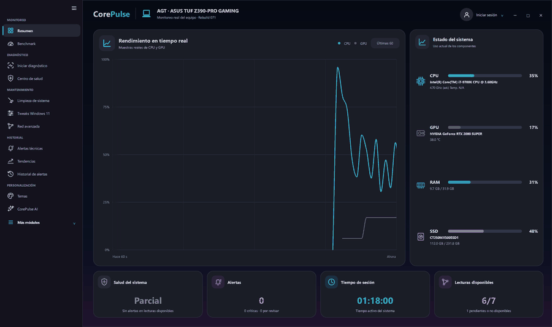
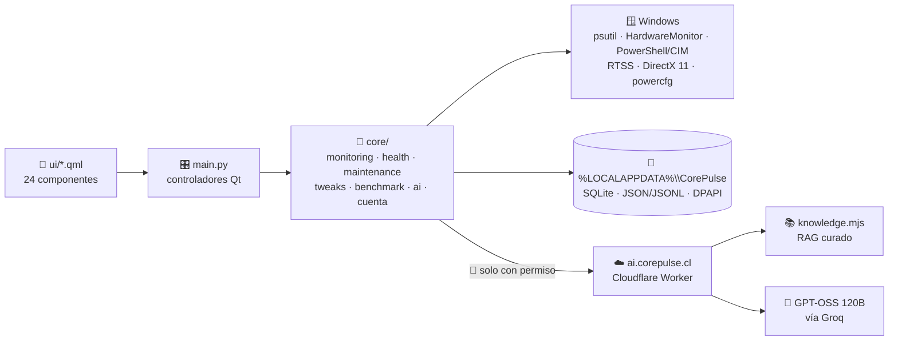

<!-- ===================== CABECERA ===================== -->
<p align="center">
  
</p>

<p align="center">
  <a href="#"></a>
</p>

<p align="center">
  
  
  
  
  
</p>

<p align="center">
  
</p>

---

## 🤔 ¿Qué es CorePulse?

¿Alguna vez abriste **cinco programas distintos** solo para saber por qué tu PC anda lenta? 🐌
Uno para temperaturas, otro para el disco, otro para los FPS, otro para limpiar...

**CorePulse junta todo en una sola app** 🧩 y además te lo explica en español, sin humo:

> 💡 Si un sensor no existe en tu equipo, CorePulse te muestra **`N/A`**.
> Nunca vas a ver un número inventado. **Dato real o nada.**

---

## ✨ Lo que trae

| | Módulo | Qué hace |
|:-:|---|---|
| 📊 | **Resumen en vivo** | CPU, GPU (🟢 NVIDIA · 🔴 AMD · 🔵 Intel), RAM y almacenamiento en tiempo real, con el logo de cada fabricante |
| 🩺 | **Centro de Salud** | Revisa Windows, repara con **DISM/SFC**, lee **SMART/NVMe** y te dice cuánto se gastó tu disco |
| 🔍 | **Diagnóstico** | Un botón ❤️‍🔥 que late mientras analiza y termina en un **PDF** listo para compartir |
| 🤖 | **CorePulse AI** | Te explica el diagnóstico con **fuentes oficiales** (Microsoft, Intel, AMD, NVIDIA) y compara la salud de tu PC **entre arranques** |
| ⚙️ | **Tweaks de Windows 11** | 78 optimizaciones que guardan **cómo estaba todo antes**: un clic y vuelve atrás ↩️ |
| 🧹 | **Limpieza** | Temporales, caché, RAM, duplicados y Papelera, siempre con confirmación |
| 🎮 | **Gaming** | Overlay con **FPS reales** (RTSS), Game Boost reversible y plan de energía automático por juego |
| 🏙️ | **Benchmark GPU** | Una ciudad de neón en **DirectX 11** que exprime tu tarjeta y guarda el historial para comparar |
| 📈 | **Tendencias** | Tu uso agrupado por **sesión de Windows**, para ver si el problema se repite |
| 🌐 | **Red avanzada** | Adaptadores, tráfico y Speedtest, con tu IP escondida detrás de un 👁️ |
| 🎨 | **Temas** | 15 paletas con estilo **Liquid Glass** 🫧 |

### 🆕 Novedades de la versión actual (REBUILD 146)

- Logotipo **AMD** completo, con el nombre de la marca y su flecha oficial.
- Icono y etiqueta de almacenamiento según lo que informa Windows: **HDD mecánico, SSD SATA o SSD NVMe**, y un icono genérico cuando Windows no informa el tipo.
- Almacenamiento en **violeta fijo**; el cian de RAM y los colores de CPU/GPU no cambian.
- Sin dependencias nuevas ni cambios en los motores de telemetría.

El detalle de cada versión está en [`versiones/HISTORIAL.md`](FASE%202/Evidencias%20Proyecto/CorePulse_REBUILD_146/versiones/HISTORIAL.md) 📜

---

## 🛡️ Las 3 reglas de oro

```text
1️⃣  Dato real o N/A          → nada se estima, nada se inventa
2️⃣  Todo se puede deshacer    → snapshot ➜ verificación ➜ restaurar
3️⃣  Nada sale sin permiso     → compartir hardware o historial viene APAGADO
```

<details>
<summary>🔐 <b>¿Qué datos salen de mi PC?</b> (clic para ver)</summary>

<br>

| Dato | ¿Sale del equipo? |
|---|---|
| Lecturas de sensores, historial, respaldos de tweaks | ❌ Nunca: quedan en `%LOCALAPPDATA%\CorePulse` |
| Preguntas que escribís a CorePulse AI | ✅ Solo las que vos enviás |
| Resumen de hardware para la IA | ⚪ Solo si activás ese permiso |
| Resumen de Tendencias para la IA | ⚪ Solo si activás ese otro permiso |
| IP, MAC, SSID, ubicación | ❌ Nunca |

</details>

---

## 🚀 Probarlo en 2 pasos

```bash
# 1️⃣ Entrá a la carpeta de la versión actual
cd "FASE 2/Evidencias Proyecto/CorePulse_REBUILD_146"

# 2️⃣ Doble clic o desde la terminal
Iniciar_CorePulse.bat
```

> ☕ La primera vez tarda un poco: prepara su propio entorno de Python e instala lo que necesita.
> Requisitos: **Windows 10/11 de 64 bits** y **Python 3.12+**.
> El encabezado de la app debe decir **Rebuild 146**. Los informes se guardan en `%LOCALAPPDATA%\CorePulse\reportes`.

---

## 🛠️ Guía técnica

> 🧭 Para quien va a meter mano al código. Si solo querés usar la app, con lo de arriba alcanza.

<p>
  
  
  
  
  
</p>

### 🗺️ El mapa del tesoro (arquitectura)



**Tres capas, una regla:** la interfaz nunca habla con Windows directo. Todo pasa por `core/`,
y lo pesado (WMI, sensores, NVIDIA-SMI) corre en hilos o procesos aparte para que la UI no se congele 🧊.

<details>
<summary>📂 <b>¿Qué hay en cada carpeta?</b> (dentro de <code>FASE 2/Evidencias Proyecto/CorePulse_REBUILD_146/</code>)</summary>

<br>

| Carpeta | Contenido |
|---|---|
| `ui/` | Pantallas QML. `GlassPanel.qml` es el material Liquid Glass 🫧 que usan todas las tarjetas |
| `core/monitoring/` | Telemetría en vivo (CPU, GPU multivendedor, RAM, disco) |
| `core/health/` | Salud, diagnóstico, PDF, FPS, Game Boost, tendencias, almacenamiento |
| `core/maintenance/` | Limpieza, red, drivers, inicio de Windows, Speedtest, test de audio |
| `core/tweaks/` | Motor de tweaks reversibles 🔄 |
| `core/ai.py` | Cliente de CorePulse AI Cloud |
| `core/benchmark_gpu.py` | El benchmark DirectX 11 de la ciudad de neón 🏙️ |
| `cloud/corepulse-ai/` | El Worker de Cloudflare: API, RAG y control de cuotas |
| `tests/` | Suite pytest de la app y del cliente cloud |
| `versiones/HISTORIAL.md` | La bitácora de cada versión 📜 |

</details>

### 💾 Dónde guarda las cosas

Todo vive en `%LOCALAPPDATA%\CorePulse`:

| Archivo | Tipo | Para qué |
|---|---|---|
| `monitoring_history.sqlite3` → `samples` | 🗃️ SQLite | Muestras cada 30 s, retención de 90 días |
| `monitoring_history.sqlite3` → `windows_sessions` | 🗃️ SQLite | Un registro por arranque de Windows |
| `monitoring_history.sqlite3` → `alert_events` | 🗃️ SQLite | Historial de alertas con su fuente |
| `windows_tweaks_state.json` | 📄 JSON | Cómo estaba Windows antes de cada tweak ↩️ |
| `benchmark_historial.jsonl` | 📄 JSONL | Hasta 500 sesiones de benchmark |
| `cuenta.dat` | 🔒 DPAPI | Token de la cuenta, cifrado por Windows |
| `reportes\` | 📄 PDF | Informes de diagnóstico y de benchmark |

### 🏃 Ejecutar y probar

```bash
cd "FASE 2/Evidencias Proyecto/CorePulse_REBUILD_146"

# ▶️ Arrancar (prepara el entorno aislado la primera vez)
Iniciar_CorePulse.bat

# 🧪 Correr las pruebas sin dejar __pycache__
python -B -m pytest -p no:cacheprovider -q tests
```

**Dependencias** (se instalan solas): `PySide6` · `psutil` · `pythonnet` · `HardwareMonitor`

---

## ☁️ CorePulse AI Cloud

El servidor de la IA vive en `FASE 2/Evidencias Proyecto/CorePulse_REBUILD_146/cloud/corepulse-ai/`: un **Cloudflare Worker** (`corepulse-ai-cloud`) publicado en **`https://ai.corepulse.cl`**. La app lo usa por defecto: el usuario no configura URL ni claves.

| Pieza | Detalle |
|---|---|
| 🧠 Modelo | GPT-OSS 120B vía **Groq** (`openai/gpt-oss-120b`). La clave del proveedor vive **solo** en Cloudflare como secreto |
| 📚 Conocimiento | RAG léxico sobre fichas oficiales curadas (Microsoft, Intel, AMD, NVIDIA) en `src/knowledge.mjs`, versión `corepulse-kb-v3`. Sin búsqueda web ni índice vectorial |
| 🔌 Rutas | `GET /v1/health` (solo confirma que responde) · `GET /v1/status` · `POST /v1/chat` · `POST /v1/analyze` (reglas propias, no gasta Groq) |
| 🚦 Límites | 8 consultas por minuto por usuario · **20** consultas generativas diarias por cuenta · **250** diarias y **3000** mensuales en total (Durable Object SQLite `MODEL_BUDGET`, reinicio en UTC) |

**Cómo responde la IA, paso a paso:**
1. 🔑 Verifica tu cuenta CorePulse contra `corepulse.cl/api/app/yo` (no confía en el `userId` que manda el cliente).
2. 🚦 Aplica el límite de consultas y el presupuesto **antes** de llamar al modelo; si no hay cupo responde `429` sin contactar a Groq.
3. 📚 Busca hasta 3 fichas oficiales relacionadas con tu pregunta (RAG).
4. 📏 Si comparás sesiones, **las reglas propias deciden** si el problema se repite (por ejemplo, CPU ≥ 90 °C durante 3 min). El modelo solo lo explica, y la respuesta trae resumen (`answer`) y dictamen completo (`details`) en una sola llamada.
5. 🔗 Las fuentes salen del catálogo, nunca del modelo.

<details>
<summary>🔐 <b>Privacidad del servidor</b></summary>

<br>

- El Worker no guarda conversaciones, IP ni telemetría en bases de datos; los contadores usan claves hash.
- Hardware: sin permiso se envía `{}`. Con permiso, solo nombres acotados y uso de CPU/GPU/RAM/disco, sin identificadores, rutas ni números de serie.
- Tendencias: un **permiso aparte, apagado por defecto**. Solo viajan contadores, picos y rachas calculados en el equipo; nunca muestras crudas, fechas exactas, nombres ni IDs.
- Nunca se aceptan mensajes de tipo `system` desde el cliente.
- Los límites cuentan **consultas**, no dinero ni tokens: configurar también alertas de gasto en el proveedor.

</details>

### 🚀 Probar y publicar el Worker

Desde PowerShell, con Node.js 22+:

```powershell
cd "FASE 2\Evidencias Proyecto\CorePulse_REBUILD_146\cloud\corepulse-ai"
npm.cmd install          # 📦 dependencias (Wrangler 4.151.1 fijado)
npm.cmd run verify       # ✅ sintaxis + 61 pruebas (simuladas, no gastan tokens)
npm.cmd audit            # 🔍 revisar antes de publicar; nunca "npm audit fix --force" a ciegas
npx.cmd wrangler whoami  # 👤 si no hay sesión: npx.cmd wrangler login (lo hace el dueño de la cuenta)
npx.cmd wrangler deploy  # 🚀 publicar en ai.corepulse.cl
```

> ⚠️ **No** volver a ejecutar `wrangler secret put`, **no** crear otro Worker, dominio ni Durable Object, y **nunca** subir tokens, claves ni `.dev.vars`.
> El deploy está completo solo cuando muestra `Deployed` junto a `ai.corepulse.cl` y un `Current Version ID`. `/v1/health` no prueba el modelo: la validación real es una pregunta autenticada desde la app.

---

## 🧭 Cómo se trabaja en el proyecto

### 📜 Reglas para crear una versión nueva

```text
📖  Leer completos "Reglas para crear Versiones nuevas.txt" y versiones/HISTORIAL.md
✍️  Agregar la entrada ARRIBA del historial: base · cambios · validación · reversión
🧹  Quitar el código que quedó obsoleto; no llenar el proyecto de .py nuevos
🧪  Correr las pruebas: ninguna versión debería sumar fallos nuevos
📦  Guardar el ZIP de respaldo de la versión anterior (con el TXT de reglas adentro)
```

### 🌳 Trabajo con Git

| ✅ Sí | ❌ No |
|---|---|
| `git pull` antes de subir | `git push --force` sobre `main` 💥 |
| Una rama por integrante (`maxi/corepulse-dev`, ...) | Subir tokens, claves o `.env` |
| Mensajes de commit claros | Subir `__pycache__` o entornos virtuales |

---

## 👥 El equipo

<table align="center">
  <tr>
    <td align="center" width="200">
      <a href="https://github.com/tomashoytbarri24"><br><b>Tomás Hoyt</b></a><br>
      🏗️ Arquitectura · 📡 Telemetría · 🤖 IA
    </td>
    <td align="center" width="200">
      <a href="https://github.com/agtttttttttttt"><br><b>Agustín Valdés</b></a><br>
      🌐 Desarrollo web · ✅ Validación · 📝 Documentación
    </td>
    <td align="center" width="200">
      <a href="https://github.com/maxicpa"><br><b>Maximiliano Carrasco</b></a><br>
      🎨 Interfaz · 🏙️ Benchmark · 🧪 Pruebas
    </td>
  </tr>
</table>

<p align="center">
  🎓 Proyecto <b>Capstone (PTY4614)</b> · Ingeniería en Informática · <b>Duoc UC</b> Valparaíso · Equipo 14
</p>

<p align="center">🧡 Hecho con mucho café por el equipo 14 · Duoc UC</p>

<p align="center">
  
</p>
