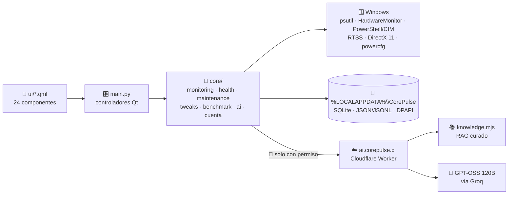

# 🛠️ CorePulse · Guía técnica

> 🧭 Para quien va a meter mano al código. Si solo querés usar la app, volvé al **[README](../README.md)**.

<p>
  
  
  
  
  
</p>

---

## 🗺️ El mapa del tesoro (arquitectura)



**Tres capas, una regla:** la interfaz nunca habla con Windows directo. Todo pasa por `core/`,
y lo pesado (WMI, sensores, NVIDIA-SMI) corre en hilos o procesos aparte para que la UI no se congele 🧊.

<details>
<summary>📂 <b>¿Qué hay en cada carpeta?</b></summary>

<br>

| Carpeta | Contenido |
|---|---|
| `ui/` | Pantallas QML. `GlassPanel.qml` es el material Liquid Glass 🫧 que usan todas las tarjetas |
| `core/monitoring/` | Telemetría en vivo (CPU, GPU multivendedor, RAM, disco) |
| `core/health/` | Salud, diagnóstico, PDF, FPS, Game Boost, tendencias, almacenamiento |
| `core/maintenance/` | Limpieza, red, drivers, inicio de Windows, Speedtest, test de audio |
| `core/tweaks/` | Motor de tweaks reversibles 🔄 |
| `core/ai.py` | Cliente de CorePulse AI Cloud |
| `core/benchmark_gpu.py` | El benchmark DirectX 11 de la ciudad de neón 🏙️ |
| `cloud/corepulse-ai/` | El Worker de Cloudflare: API, RAG y control de cuotas |
| `tests/` | Suite pytest de la app y del cliente cloud |
| `versiones/HISTORIAL.md` | La bitácora de cada versión 📜 |

</details>

---

## 💾 Dónde guarda las cosas

| Archivo | Tipo | Para qué |
|---|---|---|
| `monitoring_history.sqlite3` → `samples` | 🗃️ SQLite | Muestras cada 30 s, retención de 90 días |
| `monitoring_history.sqlite3` → `windows_sessions` | 🗃️ SQLite | Un registro por arranque de Windows |
| `monitoring_history.sqlite3` → `alert_events` | 🗃️ SQLite | Historial de alertas con su fuente |
| `windows_tweaks_state.json` | 📄 JSON | Cómo estaba Windows antes de cada tweak ↩️ |
| `benchmark_historial.jsonl` | 📄 JSONL | Hasta 500 sesiones de benchmark |
| `cuenta.dat` | 🔒 DPAPI | Token de la cuenta, cifrado por Windows |

---

## 🏃 Ejecutar y probar

```bash
# ▶️ Arrancar (prepara el entorno aislado la primera vez)
Iniciar_CorePulse.bat

# 🧪 Correr las pruebas sin dejar __pycache__
python -B -m pytest -p no:cacheprovider -q tests
```

**Dependencias** (se instalan solas): `PySide6` · `psutil` · `pythonnet` · `HardwareMonitor`

---

## ☁️ CorePulse AI Cloud

```bash
cd cloud/corepulse-ai
npm install          # 📦 dependencias (Wrangler fijado)
npm run verify       # ✅ sintaxis + 65 pruebas
npm audit            # 🔍 revisar antes de publicar
npx wrangler deploy  # 🚀 publicar en ai.corepulse.cl
```

> ⚠️ **Nunca** subas tokens ni claves. La clave del proveedor vive solo en Cloudflare
> y el usuario no tiene que configurar nada.

**Cómo responde la IA, paso a paso:**
1. 🔑 Verifica tu cuenta CorePulse.
2. 🚦 Aplica el límite de consultas y el presupuesto.
3. 📚 Busca hasta 3 fichas oficiales relacionadas con tu pregunta (RAG).
4. 📏 Si comparás sesiones, **las reglas propias deciden** si el problema se repite (por ejemplo, CPU ≥ 90 °C durante 3 min). El modelo solo lo explica.
5. 🔗 Las fuentes salen del catálogo, nunca del modelo.

---

## 📜 Reglas para crear una versión nueva

```text
📖  Leer completos "Reglas para crear Versiones nuevas.txt" y versiones/HISTORIAL.md
✍️  Agregar la entrada ARRIBA del historial: base · cambios · validación · reversión
🧹  Quitar el código que quedó obsoleto; no llenar el proyecto de .py nuevos
🧪  Correr las pruebas: ninguna versión debería sumar fallos nuevos
📦  Guardar el ZIP de respaldo de la versión anterior
```

## 🌳 Trabajo con Git

| ✅ Sí | ❌ No |
|---|---|
| `git pull` antes de subir | `git push --force` sobre `main` 💥 |
| Una rama por integrante (`maxi/corepulse-dev`, ...) | Subir tokens, claves o `.env` |
| Mensajes de commit claros | Subir `__pycache__` o entornos virtuales |

<p align="center">🧡 Hecho con mucho café por el equipo 14 · Duoc UC</p>
